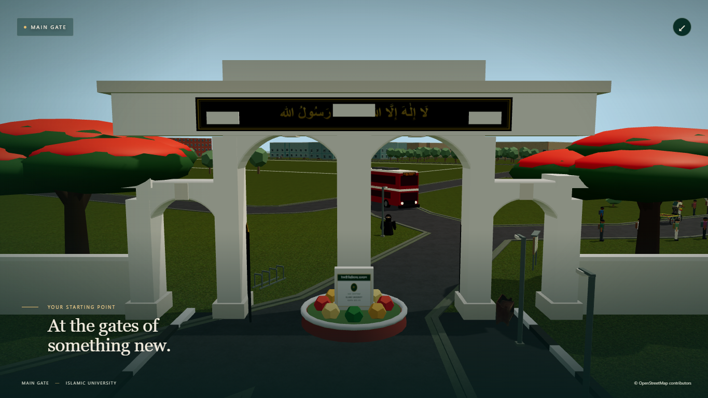

# Campus Story — Main Gate landing validation

Validated on 3 November 2026 against user revision `5220e708cbb9322dbaf021d16af751a2c2121ca1`. The newer campus-boundary implementation is preserved. This release changes the menu, its camera handoff and startup preparation; it does not change the map, movement, traffic, collision integrator, characters or voice content.

## Landing and startup

The forest-green menu uses two portraits rendered from the existing characters. Male/Hujur is the fresh-page default; early Female/Niqab choices survive initialization. Campus Student remains hidden and implemented. The existing gate artwork paints independently of WebGL. An optional expanded view shows the actual game gate once ready. Enter uses a short camera blend, skipped for reduced motion. The normal waiting menu no longer continuously renders the hidden 3D world or resets all actors on first entry.

The primary loading defect was a preparation mismatch: the game used the user's trimmed campus, but build preparation still used the untrimmed map. Every visit rejected that packet and regenerated navigation and scenery. Build preparation now matches the runtime model, verified against source generators. Map and prepared-data requests also start together. Existing checksum caching, background visual completion, full nearby materials, shader preparation and required-resource error handling remain intact.

## Automated and browser results

- `npm test`: **230 passed, zero failed**. [Full test output](validation/gate-landing/tests.txt).
- `npm run build:pages`, including `npm run build`: passed. [Build output](validation/gate-landing/build-pages.txt). Vite still warns that the main game chunk exceeds 500 KB; the separate menu script is approximately 5.27 KB uncompressed.
- Prepared roads, planting, furniture, pedestrian graph, van routes and collision triangles match runtime generation for the trimmed campus. Existing untrimmed canonical integrity checks also pass. Raw `map.osm` remains 770,269 bytes, SHA-256 `8c1c2810c8eb01496b1d5bc19919c124ea5fec5bf2977da9a1a45cf2570d79d9`.
- Production browser checks passed desktop 1365 × 768 and mobile landscape 844 × 390: early Female selection, fresh Male default, repeated switching, expanded gate/return, entry, pause/resume and 30 pedestrians/eight vans. [Results](validation/gate-landing/browser.json).
- Portrait 390 × 844 and 320 × 568 passed with no horizontal/menu overflow or missing images. An intentionally delayed game module leaves selection and help usable. Reduced motion skips the handoff. A missing required map shows an error, keeps entry disabled and successfully retries. [Recovery/layout results](validation/gate-landing/menu-checks.json).
- Desktop and touch controls passed: walking, jump, sprint, simultaneous two-finger movement/camera, pause clearing, boarding, visible player/eight drivers, acceleration, moving exit and ground landing. All four recorded clips loaded into a running audio context; no TTS or subtitles were introduced. [Controls results](validation/gate-landing/controls/controls-browser.json).
- The first controls attempt, run alongside the full CPU-heavy suite, failed its 700 ms displacement threshold. An isolated diagnostic and the unchanged full desktop/mobile controls script both passed. The startup script's separate jump assertion was corrected to wait for its 250 ms diagnostic sampling, instead of reading a stale value at 140 ms. No gameplay changes were made to satisfy these timings.
- Local Pages verification matched **58 files**, including HTML, scripts, images, prepared data, models, audio and raw map. [Asset verification](validation/gate-landing/local-assets/hosted-assets.json).

## Matched startup benchmark

Temporary headless Chrome, 1365 × 768, local HTTP, three fresh-context cold/cached pairs per build, alternating build order. No other game check was running. The prior build was served directly from Git without modifying the checkout. Both versions prepare complete nearby visuals before readiness. [All runs](validation/gate-landing/benchmark.json).

| Median | Previous build | Updated build |
| --- | ---: | ---: |
| Cold visit: Enter enabled | 10.83 s | **5.35 s** |
| Cached visit: Enter enabled | 10.51 s | **6.29 s** |
| Cold visit: stable rendered frame | 10.91 s | **5.40 s** |
| Cached visit: stable rendered frame | 10.59 s | **6.33 s** |
| Largest startup task, cold visit | 4.70 s | **2.54 s** |
| Largest startup task, cached visit | 5.40 s | **3.20 s** |

Updated menu first paint was 0.37 s cold and 0.26 s cached at the median. Entry improved about 51% cold and 40% cached. Cached visits reused downloaded resources, but still construct simulation and GPU state. Machine timing varied: updated cold entry ranged 4.86–10.12 s and cached entry 5.18–9.54 s; the later pair was slower on both builds. These are local measurements, not promised phone or Internet timings. Startup still has a substantial simulation-construction task; the menu is visible early, but full game readiness is not instantaneous. No texture-resolution or actor-count reduction was used.

## Visual evidence

## Delivery and limits

Publishing retains `main → /docs` and the [same GitHub Pages URL](https://saakiiiib.github.io/gta-islamic-university/). Release `22440d28339bc4fbabb9d38dda2b2ea71bcd0542` deployed successfully in [Pages run 41577740586](https://github.com/saakiiiib/gta-islamic-university/actions/runs/41577740586). All **58 hosted files** matched the generated release, including the unchanged map. See [hosted asset verification](validation/gate-landing/live/hosted-assets.json).

Live desktop and phone-sized Chrome checks retained early Female selection, loaded valid preparation, entered gameplay with 30 pedestrians/eight vans and reported no page errors, failed requests or horizontal overflow. Observed live entry readiness was 7.43 s desktop and 5.83 s phone-sized emulation; these individual Internet observations are separate from the controlled local benchmark. [Live browser results](validation/gate-landing/live/hosted-browser.json).

The release ZIP contains source, lockfile, raw map, production builds and validation evidence, excluding dependencies and Git internals.

Browser checks used an explicitly authorized temporary Chrome profile, with no signed-in user profile. Physical Android devices and iPhone Safari were unavailable. Touch emulation does not establish phone frame rates. Existing unit coverage checks character/vehicle resource ownership; this release does not claim a new whole-browser memory benchmark. Human listening and physical-phone audio quality were not evaluated; clip loading and audio-context operation were verified.
