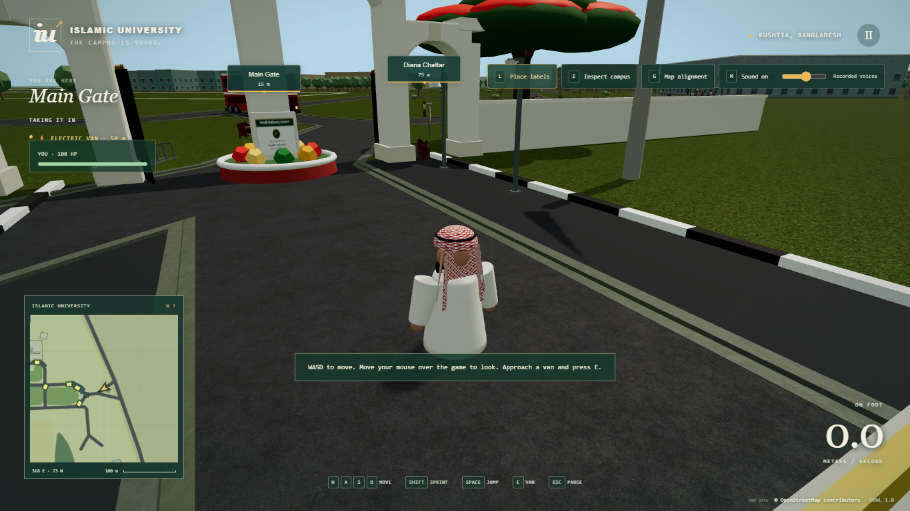

# Campus Story — mouse look and movement repair

Validated 3 November 2026 against release `8acd493589eed62ed858800ee577b4275c6653e0`.

## Reproduction and fixes

- The live in-app browser exposed no `requestPointerLock` function. The game handled only locked mouse movement and right-dragging, so ordinary mouse movement stopped rotating the camera. Unlocked desktop mouse movement now rotates over the game canvas; movement over controls, pause, inspection and touch gestures stays separate. Supported browsers retain pointer capture, a canvas click can retry capture, and event-only/Promise-based capture implementations have bounded completion and cleanup.
- Shoreline and campus-edge constraints previously rejected displacement while retaining velocity. The player could appear to run while stationary and carry blocked momentum into the next turn. Contacts now remove the blocked velocity component while retaining motion along the edge. Grounded jumps and walking away are regression-tested.
- Static/vehicle collision separation could push the player outside the campus after the initial boundary check. The accepted geographic constraints are checked after all separation too. The original campus perimeter and gate approach remain unchanged.
- Three.js Octree subdivision rounded an outer bounding-box maximum inward for the full bus hull, dropping its side triangles from collision lookup. A local subclass adds a one-micrometre maximum-bound guard. It changes acceleration bounds only; actual mesh triangles, roofs, building outlines and map collision geometry stay unchanged. Tests cover four wall directions, falling onto roofs, underside impacts, low-ceiling jumps and landing.
- The player collided with a van-sized proxy even for the much larger red bus. Bus collision now uses a cached hull matching its existing configured dimensions; the electric-van proxy is unchanged.
- After exiting a bus, its remembered session reference prevented future updates, leaving it frozen at a nonzero speed. The unoccupied bus now continues through its existing coasting, braking and collision code exactly once per fixed tick. Side-character updates also use one fixed-step duration rather than multiplying elapsed time.
- Reset placed the player at the older map spawn while resetting the chase camera at the exterior Main Gate. Both now use the same requested gate spawn. The simulation's default reset remains compatible with existing callers.
- A queued horn survived release and pause; one-shot consumption and clearing now include the horn.

## Verification

`npm test`: **243 passed, zero failed**, including the existing map/collision integrity, movement, vehicles, damage, recorded audio, inspection and touch regressions. The focused input checks also passed (19 tests), and focused physics/player/bus/boundary checks passed (40 tests). No existing test tolerance was weakened. [Full test output](validation/mouse-physics/tests.txt).

`npm run build:pages`, including `npm run build`: passed. The existing large main-chunk warning remains; no dependency or visual-quality reduction was introduced. [Build output](validation/mouse-physics/build-pages.txt).

Final Chrome tests passed all three desktop mouse modes, real keyboard Main Gate reset, walking and three consecutive jumps/landings in each mode. They also verify that hovering controls cannot rotate the camera, pause clears mouse input, and inspection returns to the previous chase orientation. [Mouse/browser results](validation/mouse-physics/mouse-browser.json).

The unchanged desktop/mobile gameplay script passed simultaneous movement/camera touch input, jumping, sprinting, boarding, visible passenger/eight drivers, acceleration, moving exit, landing and portrait layout. All four recorded clips loaded with no asset errors. [Controls results](validation/mouse-physics/controls/controls-browser.json).

The built Pages output passed desktop mouse-look/jump checks with pointer capture deliberately absent, early Female selection, phone-sized startup, valid preparation and entry with 30 pedestrians/eight vans. No page errors or failed requests occurred. All **58 production files** matched their local generated bytes, including the unchanged map. [Production browser results](validation/mouse-physics/local/hosted-browser.json), [asset verification](validation/mouse-physics/local/hosted-assets.json).

Browser automation uses the previously authorized temporary Chrome profile. The desktop fixtures exercise native capture, missing capture and rejected capture, pause/resume, real keyboard reset, walking, three consecutive jumps/landings and inspection-camera restoration. The existing desktop/mobile controls script also checks simultaneous two-finger movement/camera, jump/sprint, boarding, visible occupants, driving, moving exits and landing.

The raw OSM map SHA-256 remains `8c1c2810c8eb01496b1d5bc19919c124ea5fec5bf2977da9a1a45cf2570d79d9`. Preparation, map projection, source footprints, heights, rendering quality, 30 pedestrians, eight vans, characters and recorded clips are retained.

## Deployment

Publishing retains `main → /docs` at the existing GitHub Pages URL. Live workflow and asset verification follow publication. Reproduce the extra browser fixture with `PLAYWRIGHT_MODULE` pointing to an installed Playwright module and `node scripts/browser-mouse-physics.mjs http://127.0.0.1:5191/` against a Vite development server. `CAMPUS_MOUSE_QA=1` enables the production fallback/jump check in `scripts/browser-gate-hosted.mjs`.

## Limits

The reported walking/jumping issues were reproduced through concrete collision and contact cases. These checks do not establish that every possible collision arrangement is free of sticking. Physical-phone testing was unavailable; mobile results use Chrome touch emulation. No new whole-campus performance benchmark is claimed.
