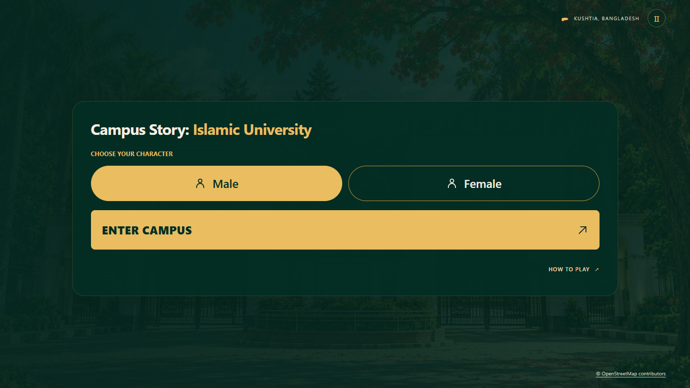
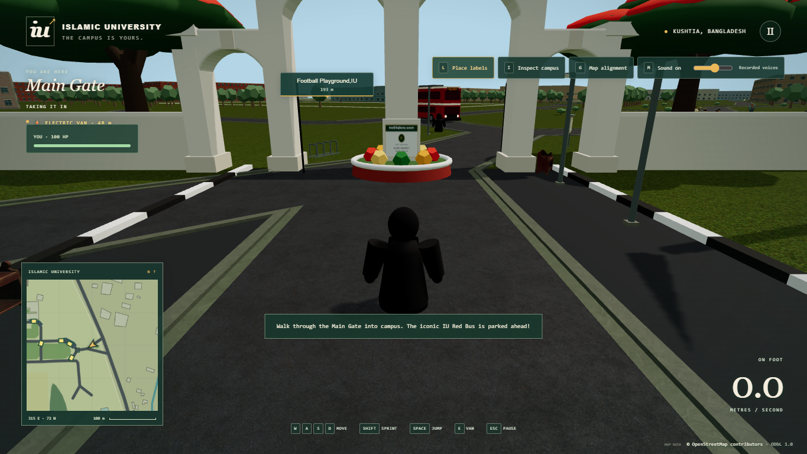
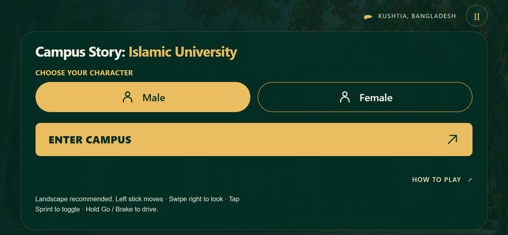

# Campus Story — landing and startup validation

Validated against the user's latest source, `5f2c051241f7ada24a29dfb2fb42fed601d92fbb`, on 28 October 2026. This updates that version in place, including its Hujur/Niqab characters, Main Gate, red bus, ambulance, horn, recorded reactions and side characters.

## Results

- `npm test`: **219 passed, zero failed**. Existing map, movement, collision, occupants, damage, audio, traffic, ambulance, inspection and touch regressions pass. A further focused run passed all 16 resource, preparation and character-resource checks after the final cleanup changes.
- `npm run build` and `npm run build:pages`: successful. Vite reports a large game chunk; the menu itself is split into an approximately 4.54 KB JavaScript chunk. No additional runtime dependency was introduced.
- Source map remains **770,269 bytes**, SHA-256 `8c1c2810c8eb01496b1d5bc19919c124ea5fec5bf2977da9a1a45cf2570d79d9`. Original footprints, heights, height sources and canonical map collision triangles pass the existing integrity checks.
- The prepared packet matches source-generated road polygons, 240 decorative trees, 48 shrubs, 78 props, 2,066 pedestrian graph nodes and 28 validated van circuits. Invalid or unavailable preparation uses the runtime generators. It adds approximately **563 KB gzip** to a first visit; texture variants and final visual quality are unchanged.
- Male maps to Hujur and is the fresh-page default. Female maps to Niqab. Early Female selection, repeated switching, character resource release, seated visibility and first-frame readiness passed browser and unit checks. Hidden Campus Student code/assets remain available internally.

## Startup measurements

Three fresh-browser-context pairs for each build, at the same 1365 × 768 desktop viewport, alternating build order. Both versions were served locally; the baseline uses the committed prior build, without changing the working checkout. Results include complete opening materials. Readiness in the new build also includes shader preparation and a rendered opening frame.

| Median | Prior release | Updated release |
| --- | ---: | ---: |
| Cold visit: entry ready | 12.95 s | 6.76 s |
| Cached visit: entry ready | 10.83 s | 5.99 s |
| Cold visit: stable rendered frame | 14.68 s | 6.83 s |
| Cached visit: stable rendered frame | 12.33 s | 6.05 s |
| Largest startup task, cold visit | 6.77 s | 3.22 s |

Raw runs and methodology: [benchmark.json](validation/startup/benchmark.json). These are headless Chrome measurements on this computer, not guarantees for Internet connections or phone hardware. The local baseline server sends uncompressed bytes while Vite preview may compress responses; download-byte totals are therefore not used as a bandwidth comparison. CPU work, shader compilation and hardware still affect later visits even when downloads are cached.

## Browser and recovery checks

Desktop and iPhone-sized Chrome touch emulation passed: menu selection, entry, walking, jump, pause/resume, portrait overflow checks, simultaneous two-finger movement/camera input, sprint, van acceleration, visible passenger/eight drivers, moving exit and landing. Thirty pedestrians/eight vans and all four recorded audio clips remain available. All normal visual families load without asset errors. See [startup browser results](validation/startup/browser.json) and [control results](validation/startup/controls/controls-browser.json).

Failure fixtures passed: missing optional artwork retains fallback geometry/materials; corrupt preparation falls back to source generation; disabled storage still starts; a missing required map displays an actionable error and successfully retries; an intentionally stalled texture stops gating startup after its 25-second request deadline. No uncaught page errors occurred in these checks. See [recovery results](validation/startup/failure-recovery.json).

The new cache uses verified content checksums for map/visual bytes and versions network URLs as well as persistent keys. Old entries for the same resource are pruned; other applications' caches are untouched. Required errors offer a reload retry. Browser storage remains optional. No service worker, installation packaging, TTS or subtitles were added.

## Delivery and limits

Publishing remains `main → /docs` at the existing GitHub Pages URL. Deployment is verified separately against the release commit and hosted files; the final delivery report states its result. The release ZIP includes source, lockfile, map, prepared data, documentation, production `dist` and `docs`, excluding dependencies and Git internals.

Physical Android hardware and actual iPhone Safari were unavailable. Touch results use Chrome emulation and do not establish physical-phone frame rates. No new runtime service or asset-service requests are required. Vehicles, NPC logic, physics, camera behaviour, campus layout and final texture resolutions remain unchanged.
