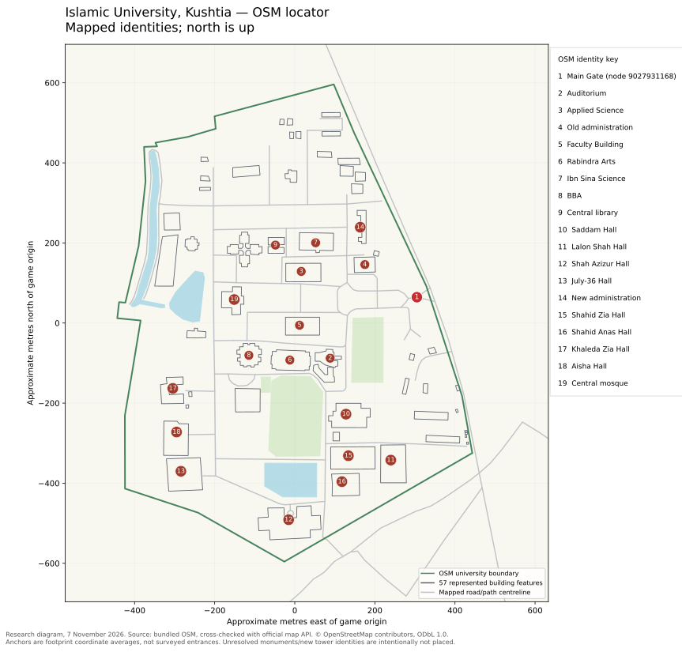

# Evidence guides Islamic University campus realism

**Research date: 7 November 2026, Asia/Dhaka.** The game already represents **57 campus building features**, but **56 heights come from generic guesses** and its building materials, roofs and windows largely come from procedural rules. The greatest realism gains will come from identifying existing footprints, recording dated height evidence and giving a few recognizable landmarks their correct silhouettes. Replacing the whole map is not justified: the official OpenStreetMap map API response retrieved today matches the bundled extract in parsed IDs, coordinates, tags, way references and relation members. A successful Overpass response is also saved, but its database date is **1 June 2026**, so its five differences must not be treated as newer corrections. The photograph collection supplies strong historical shape and color evidence, mostly from 2021, while official 2026 notices establish new building names that still need spatial matching. This report separates mapped facts, dated photo observations, reported dimensions and provisional art estimates; it does not claim that all physical campus buildings have been identified. **This is research only: no game code, workflow, deployed assets or source map changes are included.**

## The correct campus already has a useful mapped foundation

This is **Islamic University, Bangladesh / ইসলামী বিশ্ববিদ্যালয়**, at Shantidanga–Dulalpur on the Kushtia–Jhenaidah highway. The university places the campus 24 km south of Kushtia and 22 km north of Jhenaidah. The official location page embeds this campus, distinguishing it from similarly named institutions in Gazipur, Dhaka, Chattogram and other countries. The embed's viewport center is a display setting, not a surveyed campus center. ([Official university](https://iu.ac.bd/), [official location map](https://iu.ac.bd/index.php/pages/view_1/NzA=))

The game's projection origin is **23.72220495, 89.15084115**, set in [`src/config.js`](../src/config.js), and its campus boundary is [OSM way 237819447](https://www.openstreetmap.org/way/237819447). The named main entrance is [node 9027931168](https://www.openstreetmap.org/node/9027931168), **23.7227843, 89.1538330**; the game spawns at neighboring node **9027931167**, so those points should remain distinct. The Central Mosque's footprint average is **23.7227318, 89.1493578**. An independently published mosque pin around 23.7228825, 89.1492854 falls about 18 m away, a normal representative-point difference rather than evidence of a different campus. Coordinates below are latitude, longitude in WGS84 and are generally averages of source vertices, **not surveyed entrances or guaranteed points inside concave buildings**. ([OSM mosque](https://www.openstreetmap.org/way/1317423259), [mosque reference](https://en.wikipedia.org/wiki/Islamic_University_Central_Mosque))



This north-up locator outlines all 57 represented building features and labels 19 mapped identities. Unresolved monuments and new towers are deliberately unplaced; the figure is an OSM-derived locator, not an aerial photograph or a complete campus survey.

### Two fetched services disagree about freshness

The audit uses the same rectangular bounds as the bundled XML: **south 23.71545, west 89.14043, north 23.72694, east 89.16244**. The repeatable query is saved in [`docs-dev/evidence/overpass-query.overpassql`](evidence/overpass-query.overpassql):

```overpassql
[out:json][timeout:90];
nwr(23.71545,89.14043,23.72694,89.16244);
out meta center geom;
```

| Evidence snapshot | Retrieval and scope | What it establishes |
|---|---|---|
| Bundled [`public/data/map.osm`](../public/data/map.osm) | Raw 3,260 nodes, 482 ways, 14 relations; SHA-256 `8c1c2810c8eb01496b1d5bc19919c124ea5fec5bf2977da9a1a45cf2570d79d9` | Exact input used by this checkout. |
| [`osm-api-2026-11-07.osm`](evidence/osm-api-2026-11-07.osm) from the [official map API](https://api.openstreetmap.org/api/0.6/map?bbox=89.14043,23.71545,89.16244,23.72694) | HTTP 200 on 7 November 2026; same raw element counts | **Zero different/added IDs; zero source IDs absent**, comparing parsed coordinates, tags, way node references and relation members. Metadata/serialization are excluded; XML bytes/hashes are not identical. |
| [`overpass-private-coffee-2026-11-07.json`](evidence/overpass-private-coffee-2026-11-07.json) from [private.coffee Overpass](https://overpass.private.coffee/api/interpreter) | Retrieved 7 November 2026, before 07:21:02 UTC; declared database timestamp **2026-06-01T08:52:28Z**; 2,525 nodes, 482 ways, 13 relations | Successful retrieval of a stale service snapshot. Embedded geometry and nonrecursive output explain why raw counts must not be treated as a deletion comparison. |

The stale Overpass response differs at [Mir Mosharraf Hossain Academic Building 1317423240](https://www.openstreetmap.org/way/1317423240), [hall pond 1317423252](https://www.openstreetmap.org/way/1317423252), [road 1317423277](https://www.openstreetmap.org/way/1317423277), and the two [Diana Chattar polygons 1317423287](https://www.openstreetmap.org/way/1317423287) and [1317423288](https://www.openstreetmap.org/way/1317423288). It lacks names/identity tags found in the bundle; the road also has a shorter reference list, `service` rather than `unclassified`, and lacks the bundle's name/layer/oneway tags. Exact fields are in [`osm-inventory.json`](evidence/osm-inventory.json), under `comparison.changes`. Earlier DE requests returned HTTP 406 and Kumi timed out; those failures are recorded in [`OSM-RESEARCH.md`](evidence/OSM-RESEARCH.md). **Use the official API cross-check for today's map comparison; do not regress the bundled data to the stale Overpass response.**

The full rectangular extract includes surrounding settlements: the representative-center filter finds **402 building objects**, whereas the application's campus trimming produces **57**. These are different populations. Today's network fetch also cannot establish whether OSM reflects every real building completed or renamed by November. An official ten-storey building announcement without a matched footprint is an **identity gap**, not proof of an unmapped building. All OSM-derived data retains [OpenStreetMap contributor attribution and ODbL obligations](https://www.openstreetmap.org/copyright); see existing [`DATA-CREDITS.md`](../DATA-CREDITS.md).

### The application converts stored OSM into geometry in identifiable stages

The following trace is pinned to checkout base [0433e85130ad0b52aec00e77338f4e5fc81da15b](https://github.com/saakiiiib/gta-islamic-university/tree/0433e85130ad0b52aec00e77338f4e5fc81da15b). It distinguishes source-data gaps from rendering choices.

| Stage / exact files | Actual behavior | Consequence for realism |
|---|---|---|
| [`src/main.js`](../src/main.js), [`src/map/index.js`](../src/map/index.js), [`src/loading/resources.js`](../src/loading/resources.js) | Runtime fetches the packaged `data/map.osm`; verifies expected source size/hash through resource loading, then calls `loadMap`/`buildMapData` with campus trimming. | There is **no live Overpass request in normal gameplay**. OSM website edits do not appear until the packaged source and derived preparation are deliberately updated. |
| [`src/map/osm.js`](../src/map/osm.js): `parseOsm` | Validates XML; keeps node/way/relation IDs and tag values as strings; builds maps of coordinates, node refs and relation members. | Raw tags are available for later overrides, even if the renderer does not currently consume them. |
| [`src/config.js`](../src/config.js), [`src/map/geometry.js`](../src/map/geometry.js) | Projects longitude eastward into X and latitude southward into Z from the configured origin; campus boundary plus 100 m context gives working bounds. | Models must use this coordinate convention; guessed screen orientation can mirror or rotate a landmark. |
| [`src/map/osm.js`](../src/map/osm.js): relation/way assembly | Builds multipolygon outers/inners, merges outer-way tags then relation tags, suppresses represented member ways, and restores orphan courtyard rings only when uniquely enclosed by a mapped building. Closed valid building ways are also accepted. `building=no` is excluded; `building=construction` is included. | Courtyards are already supported and should survive any landmark replacement. Do not duplicate a relation and its outer way or create new geometry just because a courtyard looks empty. |
| Same file: selection and clipping | Buildings intersect working bounds; roads/water/greens are clipped as appropriate. With `trimToCampus`, buildings/roads/water are filtered to the campus plus a small gate arrival exception. Greens, trees and tree rows retain their working-bounds handling. | “Campus-derived” counts follow application behavior, not a cadastral inventory. A surrounding/context feature is not necessarily a physical campus asset. |
| Same file: `estimateHeight` | First parses `height` in metres or feet; else `building:levels × 3.2`; else name/type rules: dormitory/hostel/`hall` **12.8 m**, house/residence **6.4 m**, shed/garage/`Grarage` **3.2 m**, academic or remaining unclassified **9.6 m**. `min_height` and roof dimensions are not used. | Semantic mistakes change height: **Jia Hall Mosque becomes 12.8 m because its name contains “Hall”**, while Central Mosque becomes an unclassified 9.6 m block. Neither is a measured height. |
| [`src/world/geometry.js`](../src/world/geometry.js), [`src/world/buildWorld.js`](../src/world/buildWorld.js) | Extrudes footprint rings vertically without bevel, preserving holes; roof caps and walls get separate materials. | Every ordinary mapped building has a flat extrusion cap. Domes, pitched or stepped roof forms and auditorium volumes need explicit treatment. |
| [`src/world/appearance.js`](../src/world/appearance.js), [`src/world/facades.js`](../src/world/facades.js) | Classifies worship/construction/residential/academic/civic/unclassified; chooses deterministic class palettes using an ID hash; adds regular procedural facade/window patterns. Worship classification correctly recognizes mosque tags independently of height heuristics. | Current wall colors/window rhythm are illustrative. `building:colour`, `building:material`, `roof:shape`, `roof:height`, `roof:colour`, `roof:material` do not drive this appearance. |
| [`src/map/osm.js`](../src/map/osm.js), [`src/world/roads.js`](../src/world/roads.js) | Reads `highway` and a parseable `width`; defaults `service`/`unclassified` to **6 m**, path/footway/pedestrian/cycleway **2.2 m**, tertiary **8 m**, trunk **7 m**, otherwise **6 m**; buffers centerlines. Road appearance adds class-based pavement, verges and details. | All audited bbox features lack `width`; only one has `surface`. Widths and much pavement treatment are therefore inferred. Raw access/oneway/surface tags should not be mistaken for fully modeled lane markings or road condition. |
| Same parser, [`src/world/buildWorld.js`](../src/world/buildWorld.js), [`src/world/vegetation.js`](../src/world/vegetation.js) | Recognizes leisure garden/park/pitch; landuse forest/orchard/grass/meadow; natural wood/grassland. Reads `natural=tree` and tree rows, then supplements them with procedural planting. | One mapped tree and one tree row do not describe actual canopy cover. Much visible vegetation is illustrative rather than individually surveyed. |
| Same parser, [`src/world/appearance.js`](../src/world/appearance.js) | Reads `natural=water`/`water`, buffers waterways at `width` or **3 m**, builds bridge `1317423268` at width or **2.2 m**, elevation **0.45 m**, ramp length **4 m**. Water shares a generic color. | Lake/pond extent has a mapped basis; bank profile, aquatic plants, depth, bridge construction and color are not thereby established. |
| [`src/world/scenery.js`](../src/world/scenery.js), [`src/world/mainGate.js`](../src/world/mainGate.js) | Scenery places illustrative short boundary fences. Main gate already has a detailed custom procedural model, flanks, barriers and collision objects. No general OSM `barrier`-geometry path is implemented. | Audit and improve the **existing gate**, and survey wall segments; do not add a duplicate gate or trace a pristine wall around the property polygon. |
| [`src/map/places.js`](../src/map/places.js) | Uses `name:en`, then `name`, and `ref` for entrances; generates interior label anchors and deduplicates nearby equal names. `name:bn` alone is not a display fallback. | Bilingual naming needs deliberate handling. Current hall aliases should be recorded separately from historical plaques. |
| [`scripts/prepare-campus.mjs`](../scripts/prepare-campus.mjs), [`src/world/prepared.js`](../src/world/prepared.js), [`package.json`](../package.json) | `prepare:campus` derives road appearance, vegetation, scenery and navigation; writes `src/generated/campus-source.js` and `campus-prepared.json`; fingerprints map and relevant source. `predev`/`prebuild` invoke it. Runtime validates/hydrates preparation and can recompute it. | Future implementation must preserve map/preparation consistency. Running the standard build can rewrite generated files, which this research change intentionally avoids. |

Derived counts are **57 buildings, 40 roads, 16 green areas, 3 water features, 1 bridge, 1 tree, 1 tree row, 5 entrances and 53 deduplicated places**. Building height provenance is **13 academic guesses, 29 unclassified guesses, 11 dormitory guesses, 2 house guesses, 1 shed guess and only 1 levels-based height**. The levels-based case is [Applied Science relation 18079379](https://www.openstreetmap.org/relation/18079379), tagged `building:levels=4`; no building has explicit `height`. None of the 57 has `min_height`, the audited roof fields, or building material/color tags. There are **32 named and 25 unnamed building features**, 32 `name` tags, no `name:en`, and one `name:bn`. No `barrier` tags occur in the audited bbox. These are reproducible tag-coverage findings, not assertions that all real roofs are flat or that the campus has no wall. ([Inventory](evidence/osm-inventory.json), [repeatable analyzer](evidence/analyze-osm.mjs))

### Consolidated OSM gaps explain specific limitations in the repository

| Gap in the audited data or identity match | What the repository currently does | Evidence needed before correction |
|---|---|---|
| **No explicit heights; levels absent on 56/57 buildings** | Applies 56 name/type guesses; Central Mosque is 9.6 m and hall-name mosque is 12.8 m. | Per-block measured height or sourced storeys with date/datum; separate dome/tower dimensions from occupied floors. |
| **Roof shape/height/color/material and building color/material absent on all 57** | Flat extrusion caps, class palettes and regular windows; renderer also lacks direct consumption of these fields. | Dated elevations/roof views plus a sourced override path; distinguish visible finish from hidden structural material. |
| **25/57 building identities unnamed; bilingual/alias metadata sparse** | Unnamed objects remain generic; `name:bn` alone would not display. | OSM-ID/photo matching, official names, Bangla spelling, aliases and current signage verification. |
| **Shaheed Minar, brick memorial and other monuments lack a confirmed named OSM match** | No dedicated Minar/memorial geometry in the audited world-generation path. | Georeferenced anchor/orientation and check for existing unlabeled geometry; this is not proof footprints are absent. |
| **2026 tower names not reconciled to generic/new construction footprints** | “New Building” candidates stay generic 9.6 m; new administration already has a separate construction footprint. | Match Shahid Abrar Fahad Hall, Kobi Golam Mostafa Academic Building and administration to current site evidence; distinguish existing IDs from genuinely missing geometry. |
| **No `barrier` tags in audited bbox** | Scenery supplies illustrative fence fragments and gate-specific barriers; property boundary does not establish wall alignment. | Survey individual wall/fence segments, gaps, materials, heights and condition, especially western boundary. |
| **Only one tree and one tree row represented** | Procedural planting supplies much of the greenery. | Dated canopy/grove/important-tree survey, species only where confirmed; keep fields/paths clear. |
| **No `width` tags in audited bbox; only one `surface` tag** | Road/path/bridge/waterway defaults govern width and appearance. | Measured width, surface and edge condition for significant routes; exact bridge structure. |
| **Water names/aliases and bank details incomplete** | Three mapped waterbodies use generic treatment; lake identity/announced name remains unresolved. | Match aliases to polygons; survey bank steps, vegetation, water condition and footbridge without merging separate ponds. |
| **Pitch sport/extent mapped; fixtures/current surface unverified** | Green areas exist, but tags do not establish present goals, stands, track, lighting or wear. | Current ground-level views and measurements; development requests are not proof of existing stadium facilities. |

All quantitative tag-gap statements come from [`osm-inventory.json`](evidence/osm-inventory.json); the architectural/state gaps are qualified by the dated sources in the following register. A future survey can fill these gaps without replacing the official-API-matched source extract wholesale.

## Dated landmark evidence supports silhouettes more strongly than exact heights

The tables below are an art and verification register. **Observed** means visible in a dated photograph; **reported** means stated by the linked source; **OSM** means a mapped tag; **inference** means a temporary art envelope. A range derived from roughly 3.2–4.0 m per visible ordinary storey is not a survey, not permission to edit OSM, and unsuitable for domes or double-height halls. A roof that looks slab-like does not prove reinforced-concrete construction, and a plaster-like facade does not prove its hidden structural material. All present-day heights/materials remain unknown unless specifically sourced. Full author, license, original URL, photo date and hashes are retained in [`references/campus/image-manifest.json`](../references/campus/image-manifest.json) and [`SOURCES.md`](../references/campus/SOURCES.md).

### Major landmarks need distinct geometry and carefully dated identities

| Key; English / Bangla identity | OSM and campus position | Storeys / height evidence | Facade, roof, windows and distinctive features | Dated visual evidence / limits |
|---|---|---|---|---|
| L01 Main gate / প্রধান ফটক | [n9027931168](https://www.openstreetmap.org/node/9027931168), 23.7227843, 89.1538330; east/highway approach. Neighbor n9027931167 is game spawn. | Gate structure: storeys not applicable; overall height unknown. | Cream/white four-arch composition (two large vehicle arches and two small side arches; corrected by the 2013 front view), dark metal grilles, red-brown trims; flat projecting cornices/parapet. Split approach, planting islands and trees establish the arrival sequence. | `main-gate.jpg`, [15 Apr 2021 photo](https://commons.wikimedia.org/wiki/File:Main_gate_IU.jpg). Existing procedural gate needs reference audit. A [25 Sep 2026 report](https://www.daily-sun.com/sun-campus/899668) describes new steel-framed Kalima structures at gate and mosque; not visible in 2021. Historic mural survival is unverified. |
| L02 Central Mosque / কেন্দ্রীয় মসজিদ | [w1317423259](https://www.openstreetmap.org/way/1317423259), 23.7227318, 89.1493578; west of academic core. | **Four storeys reported**. Main dome reported **90 ft ≈27.4 m**, height datum unspecified. Game 9.6 m is a guess. **Four 150 ft ≈45.7 m minarets are planned in the report**, not verified standing structures. | Large off-white dome on polygonal drum, smaller domed towers, tall arches, light paved terraces and unfinished brown/gray wall areas. White stone/ceramic is reported; photos show an incomplete historical state. | `central-mosque.jpg`, [2 Apr 2021](https://commons.wikimedia.org/wiki/File:Central_Mosque_architectures_of_Islamic_University,_Bangladesh.jpg); `mosque-domes.jpg`, [16 Apr 2021](https://commons.wikimedia.org/wiki/File:Islamic_University_Central_Mosque_main_dome_and_others.jpg). [Daily Campus report](https://thedailycampus.com/public-university/138124), published 16 Mar 2024/updated 7 Aug 2025. Wikipedia's 150-ft dome/completion claims conflict with this; do not use 45.7 m as observed roof height. Exact current dome count and completion state need survey. |
| L03 Shaheed Minar / শহীদ মিনার | No named identity matched in audited OSM. Coordinates unresolved; match photographs before inserting geometry. | Height unknown. BTV description reports platform **116 ×75 ft ≈35.36 ×22.86 m**, plinth **9 ft ≈2.74 m**; dimensions are unverified reports. | Five white/gray open frames; taller central paired uprights, dark internal bars, red disc; reddish stepped platform, alpona and Bangla-letter motifs. Roof/windows not applicable. | `shaheed-minar.jpg`, [6 Mar 2021](https://commons.wikimedia.org/wiki/File:Shahid_Minar_IU.jpg); [BTV video](https://www.youtube.com/watch?v=AZQao0H8OrE). The video's historical date claim is inconsistent, so it is not repeated here. **Separate from the brick memorial.** |
| L04 Liberation War Martyrs' Memorial / শহীদ স্মৃতিসৌধ | No confidently matched OSM identity/coordinates. Commons description places it near main gate. | Nonbuilding monument; height unknown. | Nested red-brown brick arch/portal, narrow rectangular cutouts, broad pale stepped base; no ordinary roof/windows. | `liberation-memorial.jpg`, [16 Apr 2021](https://commons.wikimedia.org/wiki/File:Shahid_Monument,_Islamic_University,_Bangladesh.jpg). Do not reuse Shaheed Minar geometry or platform measurements. |
| L05 Khademul Haramain King Fahad Bin Abdul Aziz Central Library / খাদেমুল হারামাইন বাদশাহ ফাহদ বিন আব্দুল আজিজ কেন্দ্রীয় গ্রন্থাগার | [w532464097](https://www.openstreetmap.org/way/532464097), 23.7239533, 89.1503671; north academic core. | **Official page says 3 storeys; 2018 photograph appears to show 4 window bands**. Unresolved. Provisional **10–16 m inference** only. | Mustard/yellow plaster-like exterior, white piers/bands, dark rectangular gridded windows, two tall arched recesses and forked capitals; flat roof/deep overhang. Actual structural material unverified. | `central-library.jpg`, [21 Nov 2018](https://commons.wikimedia.org/wiki/File:Central_library_of_IU.jpg); [official three-storey description](https://iu.ac.bd/index.php/pages/view_1/Nzc=). Do not silently select four or convert window bands into verified floors. |
| L06 Existing administration / প্রশাসন ভবন | [r18079380](https://www.openstreetmap.org/relation/18079380), 23.7235161, 89.1525583; northeast core. | Storeys/height unknown; game 9.6 m is heuristic. | Building-specific material/color, roof, windows and entrance elevation unknown in the verified open-image collection. Distinct footprint from new administration. | [Official university slider/identity](https://iu.ac.bd/) is URL-only; no open licensed closeup accepted. Require current elevation/photo before appearance override. |
| L07 New administration / নতুন প্রশাসন ভবন | [w929202651](https://www.openstreetmap.org/way/929202651), 23.7243533, 89.1524454; north of existing administration. Named construction footprint is strong candidate for notice; confirm exact match. | **Ten storeys, under construction**, per 1 Nov 2026 official news; ground-floor permanent mosque inaugurated 31 Oct. **32–42 m inference** for art planning, not measured height or completion. | Current facade, roof, windows, material and completed tower profile unresolved. Model construction state only after matching a dated source. | [Official news](https://iu.ac.bd/index.php/news/details/OTQz). Existing map `building=construction` is useful; do not call it an absent footprint or fully completed tower. |
| L08 Birshreshtha Hamidur Rahman Auditorium / বীরশ্রেষ্ঠ হামিদুর রহমান মিলনায়তন | [r7650711](https://www.openstreetmap.org/relation/7650711), 23.7214158, 89.1517087; southeast of older faculty building. | Roughly 2–3 visible bands in photo; double-height hall prevents reliable storey/height conversion. Height unknown. | Brick-pink/red exterior with pale arch trim; deep double-height front arch, layered flat hall/entry roofs, pediment/arched motifs. A hall volume plus entrance, not apartment-style repetitive floors. | `auditorium.jpg`, [4 Apr 2021](https://commons.wikimedia.org/wiki/File:Architectures_of_Islamic_University,_Bangladesh._Birshreshtha_Hamidur_Rahman_Auditorium.jpg). OSM `shop=music` is not architectural evidence. |
| L09 Medical centre / চিকিৎসা কেন্দ্র | [w1468680463](https://www.openstreetmap.org/way/1468680463), 23.7239872, 89.1483213; northwest of mosque. | Three visible levels in 2021 photo; **10–13 m inference**. Current as-built count unverified; “2nd floor” in image description is ambiguous. | Cream/white plaster-like facade, dark arched corridor openings, rounded corner balconies, flat roof. | `medical-center.jpg`, [16 Apr 2021](https://commons.wikimedia.org/wiki/File:Medical_Center,_Islamic_University,_Bangladesh.jpg). |
| L10 Vice-chancellor residence / উপাচার্যের বাসভবন | [w1317423257](https://www.openstreetmap.org/way/1317423257), 23.7255002, 89.1507339; northern residential area. | Approximately 2 visible levels, tentative; **6–9 m inference**. | Pale/white low split wings, flat roofs, arched front recess, landscaped formal lawn. Window detail not reliably resolved. | `vc-residence.jpg`, [15 Apr 2021](https://commons.wikimedia.org/wiki/File:VC_Residence.jpg). Game 6.4 m is independently a fallback, not confirmation. |
| L11 Mukta Bangla / মুক্ত বাংলা | Landmark known; no confirmed OSM match or coordinate from this audit; near gate in published description. | Sculpture height unknown; storeys/roof/windows not applicable. | Pale green/white open radial arches over circular red/white stepped plinth; central sculptural element. Distinct from both memorials. | `mukta-bangla.jpg`, [16 Apr 2021](https://commons.wikimedia.org/wiki/File:Mukta_Bangla_Sculpture,_Islamic_University,_Bangladesh.jpg); [location description](https://en.wikipedia.org/wiki/Mukta_Bangla_(Islamic_University)). |
| L12 Muktir Ahban / মুক্তির আহ্বান | Historical object near Shah Aziz hall; current position/existence not verified. No confirmed OSM identity. | Monument/panel height unknown; no storeys. | Historical portrait mosaic and black text panel, white/red base. Treat historical political imagery as dated evidence, not assumed current signage. | `muktir-ahban.jpg`, [16 Apr 2021](https://commons.wikimedia.org/wiki/File:Muktir_Ahban_Sculpture,_Islamic_University,_Bangladesh.jpg). Needs present-day verification before implementation. |
| L13 Sotota Fountain / সততা ফোয়ারা | No verified OSM match/coordinates. | Height unknown; no storeys. | Stacked pale fountain bowls/spindle, shallow circular pool with light rim, planted surround; roof/windows not applicable. | `sotota-fountain.jpg`, [16 Apr 2021](https://commons.wikimedia.org/wiki/File:Sotota_Fountain,_Islamic_University,_Bangladesh.jpg). |

### Academic identities do not map one-to-one to faculties

The official university navigation lists Theology and Islamic Studies, Arts, Social Sciences, Law, Business Administration, Sciences, Engineering and Technology, Biological Sciences, and Islamic and Comparative Religion. **These are organizational faculties, not nine independently located buildings.** Existing footprint names, floor occupancy and later expansions must be reconciled rather than creating a separate generic building for each menu item. ([Official faculty navigation](https://iu.ac.bd/))

| Key; English / Bangla identity | OSM and position | Storeys / height | Facade, roof, windows and distinctive form | Source and confidence limit |
|---|---|---|---|---|
| A01 Older Faculty Building / অনুষদ ভবন | [r18079381](https://www.openstreetmap.org/relation/18079381), 23.7221552, 89.1509575 | About 3 visible bands, incomplete oblique view; **3–4 tentative**, **10–16 m inference**. | Long cream/light courtyard/U-shaped mass, repeated tall arched arcade bays, flat weathered roof, dense trees. Hidden structural material unknown. | `arts-faculty.jpg`, [15 Apr 2021](https://commons.wikimedia.org/wiki/File:Faculty_of_Arts_building,_Islamic_University,_Bangladesh.jpg). Footprint match should be checked by plan. |
| A02 Rabindra–Nazrul Arts Building / রবীন্দ্র–নজরুল কলা ভবন | [r18079382](https://www.openstreetmap.org/relation/18079382), 23.7213738, 89.1507211; mapped “Rabindra Arts building” | Exterior storeys/height unknown. | Low long cream/white wings, flat slab-like roof amid dense canopy; cream open corridors with rectangular bays/dark metal railing in interior view. | `academic-building-2.jpg`, [15 Apr 2021](https://commons.wikimedia.org/wiki/File:Academic_building_2.jpg), uploader identifies Rabindra–Nazrul; `rabindra-nazrul.jpg`, [8 Mar 2021](https://commons.wikimedia.org/wiki/File:Inner_View_of_Rabindra_Nazrul.jpg). [2025 relocation report](https://thedailycampus.com/news/printarticle/169100) is not a floor survey. |
| A03 Mir Mosharraf Hossain Academic Building / মীর মোশাররফ হোসেন একাডেমিক ভবন | [w1317423240](https://www.openstreetmap.org/way/1317423240), 23.7238575, 89.1496067 | Storeys/current height unknown; aerial cannot establish them. | Pale/white cross/quadrant courtyard composition, rectangular roof wings, central circulation hub; flat roofs. Window rhythm not resolved. | `mir-mosharraf.jpg`, [4 Mar 2021](https://commons.wikimedia.org/wiki/File:Mir_Mosharraf_Hossain_Academic_building.jpg). [University planning document](https://iu.ac.bd/public/images/notice/51598e5e3d44198ddf6e68ca24859da4.pdf) mentions upward expansion but is not completion evidence. |
| A04 Applied Science and Technology Building / ফলিত বিজ্ঞান ও প্রযুক্তি অনুষদ ভবন | [r18079379](https://www.openstreetmap.org/relation/18079379), 23.7233624, 89.1509995 | **OSM `building:levels=4`**, game 12.8 m via rule. Not measured overall height. Four visible levels in the shared complex photo cannot independently settle which block without matching. | Cream/yellow arched vertical bays, courtyard wings, flat slab-like roofs in complex; per-wing window/height match unresolved. | `science-faculty.jpg`, [17 Apr 2021](https://commons.wikimedia.org/wiki/File:The_faculty_of_science,_Islamic_University.jpg); `ibn-sina-historical.jpg`, [13 Apr 2021 metadata](https://commons.wikimedia.org/wiki/File:Nuclear_Scientist_M.A._Wazed_Miah_Science_Building_(IU).jpg) depicts both buildings. |
| A05 Ibn Sina Science Building / ইবনে সিনা বিজ্ঞান ভবন; former Nuclear Scientist M. A. Wazed Miah Science Building | [r18079384](https://www.openstreetmap.org/relation/18079384), 23.7240048, 89.1513527 | **Current storeys/height unresolved**; 2021 image predates reported upward extension completed before Dec 2022. | Cream/yellow science-complex appearance, arched bays, flat roofs, low courtyard wings; do not transfer all neighboring block features indiscriminately. | Shared [historical complex photograph](https://commons.wikimedia.org/wiki/File:Nuclear_Scientist_M.A._Wazed_Miah_Science_Building_(IU).jpg); [2022 extension report](https://www.jagonews24.com/campus/news/818981); [2025 renaming](https://www.thedailystar.net/campus/news/islamic-university-sheikh-mujibur-hall-renamed-shah-azizur-hall-3840531). |
| A06 Business Administration / ব্যবসায় প্রশাসন অনুষদ ভবন | [r18079386](https://www.openstreetmap.org/relation/18079386), 23.7214804, 89.1497170; OSM “BBA building” | Current storeys/height unknown; upward extension reported completed before Dec 2022. | Square/ring courtyard, light/cream facade sections, weathered flat roof, projecting stair/service cores. Roof-facing photograph does not resolve windows or floor count. | `business-faculty.jpg`, [15 Apr 2021](https://commons.wikimedia.org/wiki/File:Business_faculty_2.jpg); [2022 extension report](https://www.jagonews24.com/campus/news/818981). |
| A07 Kobi Golam Mostafa Academic Building / কবি গোলাম মোস্তফা একাডেমিক ভবন | **OSM match and coordinates unresolved.** Do not assign either “New Building” way without evidence. | Official **8 Feb 2026 notice describes a ten-storey academic building**; **32–42 m art inference** only. | Current facade/material, roof, windows, entry and construction/completion state unknown in accepted open photographs. | [Official notice register](https://iu.ac.bd/index.php/site/notice/MQ==), naming order dated 8 Feb 2026. It proves nomenclature, not a footprint match or a measured height. |

### Eight established hall names coexist with new ten-storey projects

The eight established names below follow the current official menu, with Bangla spellings and historical aliases retained for photo matching. March 2025 reporting records four hall renamings and Wazed Miah → Ibn Sina; July 2025 reporting found some old plaques still present. A historical sign and a current official label can therefore disagree without identifying two buildings. **Eight menu entries do not prove the campus has only eight physical halls in 2026.** ([University navigation](https://iu.ac.bd/), [Daily Star renaming report](https://www.thedailystar.net/campus/news/islamic-university-sheikh-mujibur-hall-renamed-shah-azizur-hall-3840531), [July 2025 plaque report](https://www.jagonews24.com/campus/news/1034007))

| Key; current English / Bangla name and historical alias | OSM and position | Storeys / height | Historical facade, roof, windows and recognizable form | Per-image source / limits |
|---|---|---|---|---|
| H01 Saddam Hossain Hall / সাদ্দাম হোসেন হল | [w532464712](https://www.openstreetmap.org/way/532464712), 23.7201606, 89.1520964 | Unknown; roof aerial does not establish height. | Pale gray/cream H-shaped courtyard block, recessed dark corridors, flat weathered roof. Window details unresolved. | `saddam-hall.jpg`, [2 Apr 2021](https://commons.wikimedia.org/wiki/File:Saddam_Hossain_hall,Islamic_University.jpg). |
| H02 Lalon Shah Hall / লালন শাহ হল | [w532464760](https://www.openstreetmap.org/way/532464760), 23.7191300, 89.1531940 | Unknown. | Symmetric angular/radiating courtyard wings, pale cream/gray walls, flat roofs; window pattern unverified at usable scale. | `lalon-hall.jpg`, [2 Apr 2021](https://commons.wikimedia.org/wiki/File:Lalon_Shah_Hall,_resident_hall_of_Islamic_University,_Bangladesh.jpg). Preserve actual plan rather than a rectangular block. |
| H03 Shahid Ziaur Rahman Hall / শহীদ জিয়াউর রহমান হল | [w967967197](https://www.openstreetmap.org/way/967967197), 23.7192274, 89.1521552 | About **4 visible storeys, tentative**; **13–17 m inference**. | Long parallel wings, courtyard and transverse bridges; cream/white walls, repetitive dark rectangular windows/continuous corridors, flat roof. | `shahid-zia-hall.jpg`, [15 Apr 2021](https://commons.wikimedia.org/wiki/File:Shahid_ziaur_rahman_hall.jpg). |
| H04 Shah Azizur Rahman Hall / শাহ আজিজুর রহমান হল; former Bangabandhu Sheikh Mujibur Rahman Hall | [w532464837](https://www.openstreetmap.org/way/532464837), 23.7177920, 89.1506906 | Some wings about **4 visible storeys, tentative**; **13–17 m inference**. | Orange/salmon panels, pale piers/bands, rectangular window repetition, balcony/corridor lines, connected wings and flat roofs. | `shah-aziz-historical.jpg`, [2 Apr 2021](https://commons.wikimedia.org/wiki/File:Father_of_the_Nation_Bangabandhu_Sheikh_Mujibur_Rahman_Hall,_Islamic_University,_Bangladesh.jpg). Historic mural state unverified. |
| H05 July-36 Hall / জুলাই-৩৬ হল; former Deshratna Sheikh Hasina Hall | [w532464846](https://www.openstreetmap.org/way/532464846), 23.7188794, 89.1480519 | About **5 visible levels, tentative**; **16–21 m inference**. | Symmetric courtyard/entry, cream/light-yellow plaster-like surfaces, muted salmon vertical accents, dark rectangular window bands; flat roof and triangular entry canopy/pediment. | `july-36-historical.jpg`, [16 Apr 2021](https://commons.wikimedia.org/wiki/File:Deshratna_Sheikh_Hasina_Hall,_Islamic_University,_Bangladesh.jpg). |
| H06 Ummul Mu'mineen Aisha Siddiqa Hall / উম্মুল মু’মিনীন আয়েশা সিদ্দিকা হল; former Bangamata/Begum Fazilatunnessa Mujib Hall | [w970015482](https://www.openstreetmap.org/way/970015482), 23.7197588, 89.1479448 | **Residential-block storeys and height unknown.** | Photo primarily shows a cream/white arched **entrance gate**, dark red trim, flat upper beam, small parapet openings and metal grilles. Residential facade/roof/windows unknown. | `aisha-hall-historical.jpg`, [16 Apr 2021](https://commons.wikimedia.org/wiki/File:Mother_of_the_Bengal_Begum_Fazilatunnesa_Mujib_Hall,_Islamic_University,_Bangladesh.jpg). Do not apply gate attributes to all residential wings. |
| H07 Khaleda Zia Hall / খালেদা জিয়া হল | [w970015480](https://www.openstreetmap.org/way/970015480), 23.7207381, 89.1478527 | Unknown; multiple wing heights and oblique view prevent reliable count. | Pale pink/cream courtyard/separate wings, stair cores, regular dark rectangular windows and flat roofs. | `khaleda-hall.jpg`, [15 Apr 2021](https://commons.wikimedia.org/wiki/File:Ladies_hall_(khaleda_zia_hall).jpg). |
| H08 Shahid Anas Hall / শহীদ আনাছ হল (also আনাস); former Sheikh Russel Hall | [w967967198](https://www.openstreetmap.org/way/967967198), 23.7186464, 89.1519963 | Photographed old block about **5 visible levels, tentative**; **16–21 m inference for that block only**. | Orange/ochre walls, white bands, tall rectangular window grids, large framed entry bay, flat roof and fenced landscaped forecourt. | `shahid-anas-historical.jpg`, [2 Apr 2021](https://commons.wikimedia.org/wiki/File:Sheikh_Russel_Hall_of_Islamic_University,_Bangladesh.jpg). A planned/new second block is a separate verification item. |
| H09 Shahid Abrar Fahad Hall / শহীদ আবরার ফাহাদ হল | **Footprint and coordinates unresolved.** Do not select w1317423253 or w1317423254 by name alone. | **Ten-storey male Hall-1** named in 8 Feb 2026 office order; April 2026 news describes newly built hall. **32–42 m inference**, not measured. | News photo is URL-only; open licensed present facade/material, roof, windows and exact block alignment not established here. | [Official notices](https://iu.ac.bd/index.php/site/notice/MQ==), [8 Apr 2026 Jago News](https://www.jagonews24.com/campus/news/1108442). |
| H10 Other mega-project hall blocks / অন্যান্য নতুন হল প্রকল্প | Unresolved candidate/project register; no invented IDs/coordinates. | The historic **2022 annual report** describes two male and two female ten-storey halls plus Anas second block within the mega-project; current names, as-built counts and completion must be checked individually. | Exterior details unknown. Historic project reporting/plans do not establish November 2026 constructed form. | [Official Annual Report 2022](https://www.iu.ac.bd/public/images/notice/Annual_Report_2022.pdf), [university planning document](https://iu.ac.bd/public/images/notice/51598e5e3d44198ddf6e68ca24859da4.pdf). Treat as survey queue, not extra proven missing footprints. |

### Water, fields and a broken boundary matter as much as facade color

| Key; landscape / Bangla identity | OSM and position evidence | Observable treatment and limits | Sources |
|---|---|---|---|
| S01 IU Lake / historical Mofiz Lake; Mugdha Sarobar announced / ইবি লেক–মফিজ লেক; মুগ্ধ সরোবর | Mapped unnamed lake [w1317423265](https://www.openstreetmap.org/way/1317423265) exists, but exact photo/name-to-polygon reconciliation remains to be confirmed. Do not turn “Lake road” into the waterbody's name. | 2021 photos show green water/aquatic plants, earthen banks and dense edge trees, with mosque backdrop. Existing turquoise generic water is a weak starting point. Shore profile/depth unknown. | `lake.jpg`, [16 Apr 2021](https://commons.wikimedia.org/wiki/File:IU_Lake,_also_called_Mofiz_Lake.jpg); `lake-mosque.jpg`, [16 Apr 2021](https://commons.wikimedia.org/wiki/File:Islamic_University_Lake_with_Central_Mosque_View.jpg); [23 Nov 2024 naming announcement](https://www.jagonews24.com/campus/news/983720). Formal adoption and named extent unresolved. |
| S02 Shah Aziz hall pond / শাহ আজিজুর রহমান হলের পুকুর | [w1317423252](https://www.openstreetmap.org/way/1317423252), 23.7187222, 89.1506029; named freshwater pond north of hall. | Separate waterbody from lake. Historic photograph supports broad masonry-like bank steps; does not fix current step extent/material everywhere. | `pond-steps.jpg`, [2 Dec 2010](https://commons.wikimedia.org/wiki/File:Stair_of_the_ponds_at_sheikh_mujib_hall,_Islamic_university_kushtia_-_1.jpg). |
| S03 Other unnamed pond / নাম অজানা পুকুর | [w1317423275](https://www.openstreetmap.org/way/1317423275), mapped `natural=water`, `water=pond`. No confirmed common name/photo match. | Extent mapped; bank structures, water condition and current vegetation unknown. No building storeys/roof/windows apply. | [OSM object](https://www.openstreetmap.org/way/1317423275), [local source](../public/data/map.osm). |
| S04 Lake footbridge / লেকের পদচারী সেতু (descriptive translation) | [w1317423268](https://www.openstreetmap.org/way/1317423268); renderer supplies “Lake footbridge” fallback. | Mapped `bridge=yes`, `layer=1`; actual width, railings, height and ramps unmeasured. Game 2.2 m/0.45 m/4 m are defaults. | [OSM](https://www.openstreetmap.org/way/1317423268), [`osm.js`](../src/map/osm.js). |
| S05 Cricket field / ক্রিকেট মাঠ | [w532464907](https://www.openstreetmap.org/way/532464907), 23.7202988, 89.1508501 | Mapped cricket pitch area. Historical grass/earth wear is useful; current wickets, boundary markings, stands, lights and exact surface condition unresolved. | `playground.jpg`, [13 May 2010](https://commons.wikimedia.org/wiki/File:Grass_fields_at_Islamic_university_kushtia_-_2.jpg), landscape cue only, not proven view of this exact polygon. |
| S06 Football playground / ফুটবল খেলার মাঠ | [w1317423245](https://www.openstreetmap.org/way/1317423245), 23.7217409, 89.1525560; third pitch [w1317423244](https://www.openstreetmap.org/way/1317423244) is tagged badminton. | Existing polygons/sport tags are available. No verified contemporary permanent stadium seating/track; **2026 stadium request is not evidence of an existing stadium**. | [BSS Aug 2026 infrastructure request](https://www.bssnews.net/news/410780), [OSM football](https://www.openstreetmap.org/way/1317423245). |
| S07 Mango garden / আমবাগান | [w1317423290](https://www.openstreetmap.org/way/1317423290), `landuse=orchard`, named Mango Garden. | Dense broadleaf canopy/grove and cultural-use clearing in old photo; current individual trees/species/spacing need survey. Do not populate fields as dense forest. | `mango-garden.jpg`, [18 Apr 2010](https://commons.wikimedia.org/wiki/File:Cultural_function_at_mango_garden,_islamic_university_kushtia.jpg). |
| S08 Other mapped gardens / অন্যান্য বাগান | [Banyan Tree garden r18079385](https://www.openstreetmap.org/relation/18079385), [Residential Park w532463950](https://www.openstreetmap.org/way/532463950), [Botanical Garden w1317423269](https://www.openstreetmap.org/way/1317423269), [Diana w1317423287](https://www.openstreetmap.org/way/1317423287)/[3288](https://www.openstreetmap.org/way/1317423288), [Jhal Orchard w1317423295](https://www.openstreetmap.org/way/1317423295) | These names/classifications are mapped evidence; garden-level tags do not verify every species, path, bench or boundary. Diana's two polygons need coherent identity handling. Exact current fixtures unknown. | [Source inventory](evidence/osm-inventory.json), [source map](../public/data/map.osm). |
| S09 Boundary wall/fences / সীমানাপ্রাচীর–বেড়া | Property outline [w237819447](https://www.openstreetmap.org/way/237819447) is mapped; **no audited barrier segments**. Detailed alignment/coordinates of damaged sections unresolved. | 2025 report describes low/broken western boundary and collapse near Shah Aziz hall. 2026 infrastructure request includes wall. Model only verified segments/materials/heights; do not infer a continuous pristine wall. | [Bonik Barta, 24 Sep 2025](https://en.bonikbarta.com/bangladesh/Jt4KuaecEDOYfFrm), [BSS 2026](https://www.bssnews.net/news/410780). |

At latitude about 23.722°N, a light rig should respect campus north and season. Approximate solar-noon elevation is 66.3° at equinox, 89.7° near June solstice and 42.8° near December solstice, using `90° − |latitude − declination|`; these are geometric estimates, not measured local weather. The noon sun remains to the south at this latitude, almost overhead in summer. Use Asia/Dhaka civil time and make haze, clouds and season explicit settings rather than asserting one permanent “Kushtia sky.” ([NOAA calculation method](https://gml.noaa.gov/grad/solcalc/calcdetails.html))

## Twenty follow-up tasks turn the evidence into reviewable changes

These are **prioritized proposals**, not implementation performed in this change. Each task states the files likely to change; new paths are proposals. Source map edits require independent verification rather than copying art estimates. Existing navigation, collision, courtyard and preparation behavior should remain reviewable throughout.

| Priority / task | Why and source references | Acceptance criteria | Files to touch in a future PR |
|---|---|---|---|
| **1. Add GitHub Actions checks for pull requests** | Establish repeatable review before landmark work. [`package.json`](../package.json) provides the actual commands; local baseline is 243 passing tests and isolated Vite build. | A PR-triggered workflow checks out source, selects a compatible pinned Node version, runs **`npm ci`, `npm test`, `npm run build`** in that order, fails on error, and has no deployment/publishing action. Review generated-file side effects in the ephemeral runner. | New `.github/workflows/pr-checks.yml`; optionally README contribution/check instructions. **No workflow added now.** |
| **2. Introduce sourced landmark override records** | Raw footprints are usable but generic rendering discards identity. [Inventory](evidence/osm-inventory.json), tables L/A/H above. | Schema keyed by **OSM type + ID**, with aliases, date, source URL, confidence and field-specific provenance; unknown values remain unknown; overrides never invent source tags. Deterministic validation rejects duplicate/unmatched keys. | New `src/data/campus-landmarks.js`; `src/world/appearance.js`, `src/world/buildWorld.js`; focused `tests/appearance.test.js`, `tests/world.test.js`. |
| **3. Make height provenance explicit and fix heuristic priority** | 56/57 guesses; “Jia Hall Mosque” gets dormitory height. [`osm.js`](../src/map/osm.js), L02, Appendix. | Explicit source height/levels retain precedence; sourced art override is distinguishable from OSM and fallback; worship cannot accidentally match hall heuristic; unverified/planned dimensions cannot become measured values. Include feet/metres, mosque and construction cases. | `src/map/osm.js`; proposed override schema; `tests/map.test.js`, `tests/appearance.test.js`. |
| **4. Reconcile new 2026 building identities spatially** | Ten-storey hall, academic building and administration must not be assigned by guess. [Official 8 Feb notices](https://iu.ac.bd/index.php/site/notice/MQ==), [new admin](https://iu.ac.bd/index.php/news/details/OTQz), H09/A07/L07. | Dated georeferenced evidence links each to an existing ID or demonstrates a genuinely absent footprint; explicitly resolve candidates w1317423253/3254 and w929202651. Report construction/completion separately. No speculative geometry. | `docs-dev/campus-realism.md`, `references/campus/SOURCES.md`, manifest/new licensed references; override records only after match. |
| **5. Build a Central Mosque silhouette from confirmed state** | Generic 9.6 m block misses dominant dome. L02, [mosque photo](https://commons.wikimedia.org/wiki/File:Central_Mosque_architectures_of_Islamic_University,_Bangladesh.jpg), [reported dimensions](https://thedailycampus.com/public-university/138124). | Match prayer mass, drum, main/small domes and arches to footprint; record uncertain datum. Do not construct planned 150-ft minarets as existing. Obtain recent evidence for 2026 additions; preserve entrance clearance/collision. | New `src/world/landmarks/centralMosque.js`; `src/world/buildWorld.js`, override records; new focused landmark tests and `tests/world.test.js`. |
| **6. Locate and model the Shaheed Minar** | Named identity absent; unmistakable frame/disc form. L03, [dated photo](https://commons.wikimedia.org/wiki/File:Shahid_Minar_IU.jpg), [BTV](https://www.youtube.com/watch?v=AZQao0H8OrE). | Survey anchor/orientation first; create five-frame/red-disc composition and stepped plaza. Dimensions retain “reported” status until verified; no copied Dhaka/Jahangirnagar dimensions; no duplication of an unidentified existing feature. | New `src/world/landmarks/shaheedMinar.js`; landmark records, `buildWorld.js`, `tests/world.test.js`; research updates. |
| **7. Model the separate brick memorial** | L04 must remain distinct from white Minar. [Memorial image](https://commons.wikimedia.org/wiki/File:Shahid_Monument,_Islamic_University,_Bangladesh.jpg). | Confirm anchor/orientation; model nested brick portal/cutouts/pale stepped base; label unknown height honestly; review alongside Minar and gate for three distinct objects. | New `src/world/landmarks/martyrsMemorial.js`; records, `buildWorld.js`, focused geometry/collision test. |
| **8. Audit the existing main-gate model against dated references** | Gate already exists; historical image and 2026 additions differ. L01, [2021 gate](https://commons.wikimedia.org/wiki/File:Main_gate_IU.jpg), [2026 report](https://www.daily-sun.com/sun-campus/899668). | Compare portal count/proportions, grilles, trims, islands and approach with `mainGate.js`; add only supported changes; preserve spawn/road openings and vehicle/player collision. Dated signs/murals have explicit status. | `src/world/mainGate.js`, `tests/mainGate.test.js`, `tests/campusBoundary.test.js`; reference register. |
| **9. Resolve library levels before applying a library facade** | Official 3 versus four apparent bands is unresolved. L05, [official library](https://iu.ac.bd/index.php/pages/view_1/Nzc=), [2018 image](https://commons.wikimedia.org/wiki/File:Central_library_of_IU.jpg). | Obtain elevation/current dated photo or section resolving basement/mezzanine/window-band interpretation; record result. Match yellow/white piers, arches, overhangs and gridded windows without claiming inferred height measured. | Landmark records; new library module or `src/world/facades.js`; `appearance.js`, focused tests; sources/report. |
| **10. Survey post-2022 science and business extensions** | 2021 roofs cannot establish present skyline. A04–A06, [extension report](https://www.jagonews24.com/campus/news/818981). | Match Ibn Sina versus Applied Science and each added wing/floor; retain OSM levels provenance separately. No present height copied from old overhead photographs. Produce dated per-block elevations before model update. | Reference records/report; future override records, `buildWorld.js`, `facades.js`, focused tests. |
| **11. Preserve courtyard and wing geometry while refining academics** | Plans are more distinctive than class palettes. A01–A06, [`osm.js`](../src/map/osm.js), [`geometry.js`](../src/world/geometry.js). | Relation inner rings and orphan-courtyard repairs remain intact; no duplicate outer-way buildings; refined wings/cores follow footprint orientation and do not fill courtyards. Verify older faculty arcade and Rabindra–Nazrul separately. | `src/world/geometry.js`, `src/world/buildWorld.js`, `src/world/facades.js`; `tests/map.test.js`, `tests/world.test.js`. |
| **12. Add hall aliases and dated per-hall appearance** | Official renaming and historic plaques need coexistence; generic red halls erase differences. H01–H08, [rename report](https://www.thedailystar.net/campus/news/islamic-university-sheikh-mujibur-hall-renamed-shah-azizur-hall-3840531). | Eight official names/aliases linked to IDs; distinct verified palettes/plans; no invented Aisha residential elevation, no Anas second-block height copied from old block. Signs have dates/language metadata. | Landmark records; `src/world/appearance.js`, `facades.js`, `src/map/places.js`; `tests/appearance.test.js`, `tests/map.test.js`. |
| **13. Give the auditorium its hall-and-entry massing** | Double-height arch and layered roof cannot be regular apartment windows. L08, [auditorium photo](https://commons.wikimedia.org/wiki/File:Architectures_of_Islamic_University,_Bangladesh._Birshreshtha_Hamidur_Rahman_Auditorium.jpg). | Match deep front arch, pale trim, main volume and entry roofs; avoid turning visible bands into verified storeys. Preserve relation courtyard/openings and navigable front approach. | New `src/world/landmarks/auditorium.js`; records, `buildWorld.js`; focused landmark tests. |
| **14. Verify service and residential buildings systematically** | Cafeteria, post office, garage, IIER, gym, guest house, teacher dorms and 25 unnamed features lack exterior evidence. Appendix. | Complete dated ID-to-photo register for every requested building; record unknowns rather than fill generic materials. Resolve `Grarage` as display alias while retaining raw tag; distinguish each anonymous feature and school footprint. | Research report/manifest; future landmark records, `places.js`; source XML only with verified OSM correction through appropriate process. |
| **15. Reconcile all three waterbodies and the bridge** | Existing water is mapped; identity/bank treatment uncertain. S01–S04, [lake photo](https://commons.wikimedia.org/wiki/File:IU_Lake,_also_called_Mofiz_Lake.jpg), [pond steps](https://commons.wikimedia.org/wiki/File:Stair_of_the_ponds_at_sheikh_mujib_hall,_Islamic_university_kushtia_-_1.jpg). | Match named lake aliases to exact polygon, retain separate hall/unnamed ponds; survey bank steps/plants and bridge width/rails. Use plausible green water and shallow-edge treatment with bounded geometry cost. | `src/world/buildWorld.js`, `appearance.js`, `scenery.js`, new bridge/bank module if needed; `tests/world.test.js`, navigation tests. |
| **16. Survey road widths, surfaces and important footpaths** | Every audited width is absent; current buffers are defaults. [`osm.js`](../src/map/osm.js), S04, main-gate reference. | Capture dated width/surface/edge/entry evidence for main approach, academic loop, hall access and lake path; preserve vehicle turning clearances and walkability. Do not mistake `oneway` metadata for surveyed lane geometry. | Landmark/road evidence records; `src/map/osm.js`, `src/world/roads.js`, navigation/vehicle route files; map, navigation and vehicle tests. |
| **17. Replace illustrative boundary fences with verified segments** | Property polygon is not an intact wall. S09, [2025 damage](https://en.bonikbarta.com/bangladesh/Jt4KuaecEDOYfFrm), [2026 request](https://www.bssnews.net/news/410780). | Store segment geometry, gaps, condition, material and confidence; reproduce confirmed gates/openings; no full-perimeter pristine wall. Collision follows only actual modeled barriers. | `src/world/scenery.js`, `src/world/mainGate.js` if flanks affected; new boundary evidence data; `tests/campusBoundary.test.js`, navigation tests. |
| **18. Place vegetation and field detail by landscape evidence** | One mapped tree cannot represent dense groves; fields should remain open. S05–S08, [garden](https://commons.wikimedia.org/wiki/File:Cultural_function_at_mango_garden,_islamic_university_kushtia.jpg), [field](https://commons.wikimedia.org/wiki/File:Grass_fields_at_Islamic_university_kushtia_-_2.jpg). | Distinguish grove canopy, approach palms, shrubs, orchard and open pitch; survey important tree/field fixtures. No invented stadium stands or unverified species monoculture; stable seeded placement and collision clearances. | `src/world/vegetation.js`, `appearance.js`, `scenery.js`; vegetation/world/navigation tests as applicable. |
| **19. Make Bangla names and current/historical aliases searchable** | `name:bn` alone is ignored; mixed-script names and duplicates exist. [`places.js`](../src/map/places.js), hall table, official menu. | Display/search English and Bangla intentionally; preserve raw OSM names and historical aliases; use legible Bangla fonts; no accidental duplicate place labels; new 2026 identities appear only after verified placement. | `src/map/places.js`, relevant search/map UI files, landmark records; place/search tests. |
| **20. Calibrate Kushtia sky/lighting and validate views/performance** | Visual fidelity must remain usable; historic skies are cues, not permanent weather. `campus-sky.jpg`, [26 Apr 2010](https://commons.wikimedia.org/wiki/File:Cloudy_sky_at_islamic_university_kushtia_.jpg); [NOAA](https://gml.noaa.gov/grad/solcalc/calcdetails.html), [`prepared.js`](../src/world/prepared.js). | Fixed camera comparisons at gate/mosque/library/halls; north/season-correct sun and explicit haze/cloud/season settings appropriate to chosen view; desktop/mobile gameplay and collision smoke checks; preparation invalidates for landmark-data changes; tests/build pass and geometry/draw-call/asset budgets are recorded before/after. | `src/world/buildWorld.js`, lighting configuration, `scripts/prepare-campus.mjs`, `src/world/prepared.js`, browser QA scripts and docs; relevant tests. |

## Appendix: all 57 represented buildings remain individually traceable

This appendix exhausts `gameDerived.buildings` in [`osm-inventory.json`](evidence/osm-inventory.json). It is **not a complete physical-campus register**. IDs are clickable OSM objects; relation source outer-way IDs are retained in the inventory. Bangla labels below are either cited campus names or **descriptive translations**, not a claim that `name:bn` exists in OSM. “Unnamed / নাম অজানা” deliberately preserves missing identity. The “game height” column records current implementation output and never substitutes for real storeys. The detail-key column points to the fully sourced landmark tables above. **U** means real storeys/height, facade material/color, roof, windows and distinctive exterior are all unknown in this research pass; the table does not spread generic “red brick/flat roof” assumptions across unobserved buildings.

<!-- BUILDING_APPENDIX -->
| # | OSM object | English / Bangla name | Representative position (lat, lon) | Real storeys / height evidence | Current game height / provenance | Facade, roof, windows and distinctive features / detail key |
|---|---|---|---|---|---|---|
| 1 | [r7650711](https://www.openstreetmap.org/relation/7650711) | Birshreshtha Hamidur Rahman Auditorium / বীরশ্রেষ্ঠ হামিদুর রহমান মিলনায়তন | 23.7214158, 89.1517087 | Unknown; double-height hall; 2–3 photo bands do not establish floors | **9.6 m**; `estimate:academic` | Brick-pink/red, pale arch trim; layered flat roofs; deep front arch; hall windows/bands; see L08 |
| 2 | [r18079379](https://www.openstreetmap.org/relation/18079379) | Applied Science and Technology Building / ফলিত বিজ্ঞান ও প্রযুক্তি অনুষদ ভবন | 23.7233624, 89.1509995 | 4 levels in OSM; overall height unmeasured | **12.8 m**; `building:levels` | Cream/yellow complex, arches, courtyard/flat roofs; per-block attribution unresolved; see A04 |
| 3 | [r18079380](https://www.openstreetmap.org/relation/18079380) | Existing administration / প্রশাসন ভবন | 23.7235161, 89.1525583 | Unknown | **9.6 m**; `estimate:academic` | Unknown material/color, roof, windows and distinctive exterior; see L06 |
| 4 | [r18079381](https://www.openstreetmap.org/relation/18079381) | Older Faculty Building / অনুষদ ভবন | 23.7221551, 89.1509575 | 3–4 tentative; 10–16 m art inference | **9.6 m**; `estimate:academic` | Cream/light, tall arched arcade; flat weathered roof, courtyard; see A01 |
| 5 | [r18079382](https://www.openstreetmap.org/relation/18079382) | Rabindra–Nazrul Arts Building / রবীন্দ্র–নজরুল কলা ভবন | 23.7213738, 89.1507211 | Unknown | **9.6 m**; `estimate:academic` | Cream/white wings, flat roof; rectangular open corridor bays/railing; see A02 |
| 6 | [r18079384](https://www.openstreetmap.org/relation/18079384) | Ibn Sina Science Building / ইবনে সিনা বিজ্ঞান ভবন | 23.7240048, 89.1513527 | Unknown current state; post-2021 extension | **9.6 m**; `estimate:academic` | Historical cream/yellow science complex, arched bays/flat roofs; current extension unresolved; see A05 |
| 7 | [r18079386](https://www.openstreetmap.org/relation/18079386) | Business Administration / BBA Building / ব্যবসায় প্রশাসন অনুষদ ভবন | 23.7214804, 89.1497170 | Unknown current state; post-2021 extension | **9.6 m**; `estimate:academic` | Historical light/cream courtyard ring, flat roof/cores; windows unresolved; see A06 |
| 8 | [w532464097](https://www.openstreetmap.org/way/532464097) | Central Library / কেন্দ্রীয় গ্রন্থাগার | 23.7239533, 89.1503671 | Official 3 versus apparent 4 bands unresolved; 10–16 m art inference | **9.6 m**; `estimate:academic` | Mustard/yellow with white piers/bands; flat overhang roof; gridded windows/arched recesses; see L05 |
| 9 | [w532464636](https://www.openstreetmap.org/way/532464636) | Central Cafeteria / কেন্দ্রীয় ক্যাফেটেরিয়া | 23.7211053, 89.1515939 | Unknown | **9.6 m**; `estimate:unclassified` | Unknown facade material/color, roof, windows and distinctive exterior (U) |
| 10 | [w532464653](https://www.openstreetmap.org/way/532464653) | Garage (raw name: “Grarage”) / গ্যারেজ (descriptive) | 23.7245166, 89.1477922 | Unknown | **3.2 m**; `estimate:shed` | Unknown facade material/color, roof, windows and distinctive exterior (U) |
| 11 | [w532464712](https://www.openstreetmap.org/way/532464712) | Saddam Hossain Hall / সাদ্দাম হোসেন হল | 23.7201606, 89.1520964 | Unknown | **12.8 m**; `estimate:dormitory` | Pale gray/cream H-plan, recessed corridors; flat weathered roof; windows unresolved; see H01 |
| 12 | [w532464760](https://www.openstreetmap.org/way/532464760) | Lalon Shah Hall / লালন শাহ হল | 23.7191300, 89.1531940 | Unknown | **12.8 m**; `estimate:dormitory` | Pale cream/gray angular courtyard wings, flat roofs; windows unresolved; see H02 |
| 13 | [w532464837](https://www.openstreetmap.org/way/532464837) | Shah Azizur Rahman Hall / শাহ আজিজুর রহমান হল | 23.7177920, 89.1506906 | About 4 photo storeys, tentative; 13–17 m art inference | **12.8 m**; `estimate:dormitory` | Orange/salmon with pale bands; flat roofs; rectangular windows/corridors; see H04 |
| 14 | [w532464846](https://www.openstreetmap.org/way/532464846) | July-36 Hall / জুলাই-৩৬ হল | 23.7188794, 89.1480519 | About 5 photo levels, tentative; 16–21 m art inference | **12.8 m**; `estimate:dormitory` | Cream/yellow with salmon accents; flat roof/triangular entry; dark rectangular windows; see H05 |
| 15 | [w532465115](https://www.openstreetmap.org/way/532465115) | IU Post Office / ইবি ডাকঘর (descriptive) | 23.7215921, 89.1541855 | Unknown | **9.6 m**; `estimate:unclassified` | Unknown facade material/color, roof, windows and distinctive exterior (U) |
| 16 | [w929202651](https://www.openstreetmap.org/way/929202651) | New Administrative Building (raw typo “Builiding”) / নতুন প্রশাসন ভবন | 23.7243533, 89.1524454 | Ten storeys reported for new administration; confirm notice/footprint match; 32–42 m inference | **9.6 m**; `estimate:academic` | Current facade/material, roof, windows and completed profile unknown; see L07 |
| 17 | [w929203013](https://www.openstreetmap.org/way/929203013) | Unnamed / নাম অজানা | 23.7237776, 89.1528291 | Unknown | **9.6 m**; `estimate:unclassified` | Unknown facade material/color, roof, windows and distinctive exterior (U) |
| 18 | [w929433965](https://www.openstreetmap.org/way/929433965) | New Teacher Dormitory (translation) / নতুন শিক্ষক ডরমিটরি | 23.7256233, 89.1495853 | Unknown | **12.8 m**; `estimate:dormitory` | Unknown facade material/color, roof, windows and distinctive exterior (U) |
| 19 | [w929434313](https://www.openstreetmap.org/way/929434313) | Guest House, IU / অতিথিশালা (descriptive) | 23.7252389, 89.1523425 | Unknown | **6.4 m**; `estimate:house` | Unknown facade material/color, roof, windows and distinctive exterior (U) |
| 20 | [w930117132](https://www.openstreetmap.org/way/930117132) | Unnamed / নাম অজানা | 23.7264380, 89.1509200 | Unknown | **9.6 m**; `estimate:unclassified` | Unknown facade material/color, roof, windows and distinctive exterior (U) |
| 21 | [w930117133](https://www.openstreetmap.org/way/930117133) | Unnamed / নাম অজানা | 23.7267324, 89.1507141 | Unknown | **9.6 m**; `estimate:unclassified` | Unknown facade material/color, roof, windows and distinctive exterior (U) |
| 22 | [w930117134](https://www.openstreetmap.org/way/930117134) | Unnamed / নাম অজানা | 23.7267279, 89.1505166 | Unknown | **9.6 m**; `estimate:unclassified` | Unknown facade material/color, roof, windows and distinctive exterior (U) |
| 23 | [w930117135](https://www.openstreetmap.org/way/930117135) | Unnamed / নাম অজানা | 23.7264291, 89.1507562 | Unknown | **9.6 m**; `estimate:unclassified` | Unknown facade material/color, roof, windows and distinctive exterior (U) |
| 24 | [w930117136](https://www.openstreetmap.org/way/930117136) | Unnamed / নাম অজানা | 23.7260005, 89.1515329 | Unknown | **9.6 m**; `estimate:unclassified` | Unknown facade material/color, roof, windows and distinctive exterior (U) |
| 25 | [w930117137](https://www.openstreetmap.org/way/930117137) | Teacher Dormitory 2 / শিক্ষক ডরমিটরি ২ (descriptive) | 23.7258436, 89.1521134 | Unknown | **12.8 m**; `estimate:dormitory` | Unknown facade material/color, roof, windows and distinctive exterior (U) |
| 26 | [w930117138](https://www.openstreetmap.org/way/930117138) | Unnamed / নাম অজানা | 23.7256381, 89.1520809 | Unknown | **9.6 m**; `estimate:unclassified` | Unknown facade material/color, roof, windows and distinctive exterior (U) |
| 27 | [w930117139](https://www.openstreetmap.org/way/930117139) | Unnamed / নাম অজানা | 23.7255083, 89.1524219 | Unknown | **9.6 m**; `estimate:unclassified` | Unknown facade material/color, roof, windows and distinctive exterior (U) |
| 28 | [w930862510](https://www.openstreetmap.org/way/930862510) | Unnamed / নাম অজানা | 23.7258859, 89.1486111 | Unknown | **9.6 m**; `estimate:unclassified` | Unknown facade material/color, roof, windows and distinctive exterior (U) |
| 29 | [w930862511](https://www.openstreetmap.org/way/930862511) | Unnamed / নাম অজানা | 23.7254592, 89.1486197 | Unknown | **9.6 m**; `estimate:unclassified` | Unknown facade material/color, roof, windows and distinctive exterior (U) |
| 30 | [w930862512](https://www.openstreetmap.org/way/930862512) | Unnamed / নাম অজানা | 23.7252197, 89.1486159 | Unknown | **9.6 m**; `estimate:unclassified` | Unknown facade material/color, roof, windows and distinctive exterior (U) |
| 31 | [w967965555](https://www.openstreetmap.org/way/967965555) | Unnamed / নাম অজানা | 23.7197812, 89.1550322 | Unknown | **9.6 m**; `estimate:unclassified` | Unknown facade material/color, roof, windows and distinctive exterior (U) |
| 32 | [w967965556](https://www.openstreetmap.org/way/967965556) | Unnamed / নাম অজানা | 23.7197349, 89.1550385 | Unknown | **9.6 m**; `estimate:unclassified` | Unknown facade material/color, roof, windows and distinctive exterior (U) |
| 33 | [w967965557](https://www.openstreetmap.org/way/967965557) | Unnamed / নাম অজানা | 23.7196665, 89.1550315 | Unknown | **9.6 m**; `estimate:unclassified` | Unknown facade material/color, roof, windows and distinctive exterior (U) |
| 34 | [w967965558](https://www.openstreetmap.org/way/967965558) | Unnamed / নাম অজানা | 23.7195147, 89.1550689 | Unknown | **9.6 m**; `estimate:unclassified` | Unknown facade material/color, roof, windows and distinctive exterior (U) |
| 35 | [w967967197](https://www.openstreetmap.org/way/967967197) | Shahid Ziaur Rahman Hall / শহীদ জিয়াউর রহমান হল | 23.7192274, 89.1521552 | About 4 photo storeys, tentative; 13–17 m art inference | **12.8 m**; `estimate:dormitory` | Cream/white parallel wings, flat roof; dark rectangular windows/bridging corridors; see H03 |
| 36 | [w967967198](https://www.openstreetmap.org/way/967967198) | Shahid Anas Hall / শহীদ আনাছ হল | 23.7186464, 89.1519963 | Old block about 5 photo levels, tentative; 16–21 m inference | **12.8 m**; `estimate:dormitory` | Orange/ochre, white bands, flat roof; tall window grids/framed entry; old block only; see H08 |
| 37 | [w970015480](https://www.openstreetmap.org/way/970015480) | Khaleda Zia Hall / খালেদা জিয়া হল | 23.7207381, 89.1478527 | Unknown; differing wings | **12.8 m**; `estimate:dormitory` | Pale pink/cream courtyard wings/cores; flat roof, regular dark rectangular windows; see H07 |
| 38 | [w970015481](https://www.openstreetmap.org/way/970015481) | Unnamed / নাম অজানা | 23.7203390, 89.1482012 | Unknown | **9.6 m**; `estimate:unclassified` | Unknown facade material/color, roof, windows and distinctive exterior (U) |
| 39 | [w970015482](https://www.openstreetmap.org/way/970015482) | Ummul Mu'mineen Aisha Siddiqa Hall / উম্মুল মু’মিনীন আয়েশা সিদ্দিকা হল | 23.7197588, 89.1479448 | Unknown residential block; photo shows gate | **12.8 m**; `estimate:dormitory` | Residential facade, roof/windows unknown; source shows cream/red entrance gate only; see H06 |
| 40 | [w970015483](https://www.openstreetmap.org/way/970015483) | Unnamed / নাম অজানা | 23.7206189, 89.1482744 | Unknown | **9.6 m**; `estimate:unclassified` | Unknown facade material/color, roof, windows and distinctive exterior (U) |
| 41 | [w970122772](https://www.openstreetmap.org/way/970122772) | Central Gymnasium, IU / কেন্দ্রীয় ব্যায়ামাগার (descriptive) | 23.7205244, 89.1496269 | Unknown | **9.6 m**; `estimate:unclassified` | Unknown facade material/color, roof, windows and distinctive exterior (U) |
| 42 | [w970122774](https://www.openstreetmap.org/way/970122774) | Unnamed / নাম অজানা | 23.7214575, 89.1537038 | Unknown | **9.6 m**; `estimate:unclassified` | Unknown facade material/color, roof, windows and distinctive exterior (U) |
| 43 | [w970122775](https://www.openstreetmap.org/way/970122775) | Unnamed / নাম অজানা | 23.7208232, 89.1535598 | Unknown | **9.6 m**; `estimate:unclassified` | Unknown facade material/color, roof, windows and distinctive exterior (U) |
| 44 | [w986167436](https://www.openstreetmap.org/way/986167436) | Unnamed / নাম অজানা | 23.7207581, 89.1548269 | Unknown | **9.6 m**; `estimate:unclassified` | Unknown facade material/color, roof, windows and distinctive exterior (U) |
| 45 | [w986167437](https://www.openstreetmap.org/way/986167437) | Unnamed / নাম অজানা | 23.7202391, 89.1548060 | Unknown | **9.6 m**; `estimate:unclassified` | Unknown facade material/color, roof, windows and distinctive exterior (U) |
| 46 | [w1317423240](https://www.openstreetmap.org/way/1317423240) | Mir Mosharraf Hossain Academic Building / মীর মোশাররফ হোসেন একাডেমিক ভবন | 23.7238575, 89.1496067 | Unknown; overhead photo cannot establish floors | **9.6 m**; `estimate:academic` | Pale cross/quadrant courtyard and central hub; flat roofs; windows unresolved; see A03 |
| 47 | [w1317423241](https://www.openstreetmap.org/way/1317423241) | Islamic Institute of Education and Research / IIER / ইসলামিক শিক্ষা ও গবেষণা ইনস্টিটিউট (descriptive) | 23.7219878, 89.1483991 | Unknown | **9.6 m**; `estimate:academic` | Unknown facade material/color, roof, windows and distinctive exterior (U) |
| 48 | [w1317423253](https://www.openstreetmap.org/way/1317423253) | New Building (identity unresolved) / নতুন ভবন (descriptive) | 23.7201467, 89.1541028 | Unknown; construction tag does not establish ten floors | **9.6 m**; `estimate:unclassified` | Unknown facade material/color, roof, windows and distinctive exterior (U) |
| 49 | [w1317423254](https://www.openstreetmap.org/way/1317423254) | New Building (identity unresolved) / নতুন ভবন (descriptive) | 23.7196167, 89.1543876 | Unknown; construction tag does not establish ten floors | **9.6 m**; `estimate:unclassified` | Unknown facade material/color, roof, windows and distinctive exterior (U) |
| 50 | [w1317423257](https://www.openstreetmap.org/way/1317423257) | Vice-chancellor residence / উপাচার্যের বাসভবন | 23.7255002, 89.1507339 | About 2 photo levels, tentative; 6–9 m art inference | **6.4 m**; `estimate:house` | Pale/white split wings, flat roofs, arched recess/formal lawn; window detail unresolved; see L10 |
| 51 | [w1317423259](https://www.openstreetmap.org/way/1317423259) | Central Mosque / কেন্দ্রীয় মসজিদ | 23.7227318, 89.1493578 | Four storeys reported; dome 90 ft (~27.4 m) reported with unspecified datum | **9.6 m**; `estimate:unclassified` | Off-white domes/drum/arches, unfinished sections and terrace; reported stone/ceramic; see L02 |
| 52 | [w1317423270](https://www.openstreetmap.org/way/1317423270) | Unnamed school-tagged footprint / নাম অজানা | 23.7268873, 89.1516814 | Unknown | **9.6 m**; `estimate:academic` | Unknown facade material/color, roof, windows and distinctive exterior (U) |
| 53 | [w1317423271](https://www.openstreetmap.org/way/1317423271) | Unnamed school-tagged footprint / নাম অজানা | 23.7264591, 89.1516899 | Unknown | **9.6 m**; `estimate:academic` | Unknown facade material/color, roof, windows and distinctive exterior (U) |
| 54 | [w1317423300](https://www.openstreetmap.org/way/1317423300) | Jia Hall Mosque (raw OSM spelling) / জিয়া হল মসজিদ (descriptive) | 23.7196768, 89.1518416 | Unknown; hall-name heuristic is inappropriate evidence | **12.8 m**; `estimate:dormitory` | Unknown facade material/color, roof, windows and distinctive exterior (U) |
| 55 | [w1468678933](https://www.openstreetmap.org/way/1468678933) | Unnamed / নাম অজানা | 23.7207581, 89.1540324 | Unknown | **9.6 m**; `estimate:unclassified` | Unknown facade material/color, roof, windows and distinctive exterior (U) |
| 56 | [w1468678934](https://www.openstreetmap.org/way/1468678934) | Unnamed / নাম অজানা | 23.7237055, 89.1476896 | Unknown | **9.6 m**; `estimate:unclassified` | Unknown facade material/color, roof, windows and distinctive exterior (U) |
| 57 | [w1468680463](https://www.openstreetmap.org/way/1468680463) | Islamic University Medical Centre / চিকিৎসা কেন্দ্র | 23.7239872, 89.1483213 | Three photo levels, tentative; 10–13 m art inference | **9.6 m**; `estimate:academic` | Cream/white, flat roof, dark arched corridors/rounded balconies; see L09 |
<!-- /BUILDING_APPENDIX -->

The six other green features represented alongside the named gardens are w1317423237, w1317423238, w1317423293 and w1468678935 (`leisure=garden`), and w1317423296/w1317423299 (`landuse=forest`). Their names, fixtures and current vegetation detail are unresolved. These are not omitted buildings. The badminton pitch w1317423244 is already identified in S06. Source counts should continue to distinguish mapped features from inferred artistic props.

### What this research verifies, and what still requires field evidence

The supplied code baseline passed **243 tests with zero failures**, and a direct Vite build to an isolated work directory passed with a chunk-size warning above 500 kB. Exact scope and results are recorded in [`docs-dev/evidence/VALIDATION.md`](evidence/VALIDATION.md). Those checks support the starting checkout, not the future tasks. Standard `npm ci`, `npm run build` and preparation commands were not run during this research because they can modify dependencies/generated files. No browser gameplay or production-quality claim follows from unit tests and a bundle build. The first proposed task supplies the requested clean PR environment for all three commands.

The reference folder contains **33 open-license photographs** with per-file author/license records. The accepted files are CC0, CC BY or CC BY-SA; Commons reduced-resolution derivatives were downloaded and renamed without crop, retouching or color alteration. Many dates are EXIF/source-description dates, and upload dates can be years later: `main-gate.jpg`, for example, was photographed in 2021 despite a 2026 upload. The 2010 field/garden/pond references are especially old; 2018 library and 2021 building photographs predate repainting, extensions and several renamings. Colors depend on exposure, weather and grading, and are useful palette cues rather than measured albedo. Full attribution and modification obligations remain in [`SOURCES.md`](../references/campus/SOURCES.md) and the manifest. University/news/YouTube and Google/Bing map imagery is **URL-only**; no such image was copied into the reference collection.

The evidence supports a clear implementation order: protect the existing build with PR checks, resolve identity/height provenance, then refine recognizable masses while preserving the footprint and courtyard foundation. The largest remaining information need is a **dated, georeferenced survey of new towers, entrances, facade elevations and boundary gaps**. That survey will let the game gain realism without turning historical photographs, planned projects or anonymous polygons into invented present-day facts.

## Implementation follow-through — 11 November 2026

The report above remains the dated research baseline. Its proposed tasks now have separately reviewable implementation/evidence changes. The [status register](realism-implementation-status.md) distinguishes delivered code from pending survey/interactive criteria; [lighting and validation](lighting-and-validation.md) records the final322-test/build results and CPU budget limits. Do not interpret the original appendix values as current art overrides or mark every task fully surveyed.
